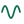

# My Projects

I write open-source C++ libraries that give Arduino, ESP32, RP2040 and STM32 boards audio, codecs, speech and networking.

- [Browse all projects by topic and platform](https://pschatzmann.github.io/pschatzmann/)

- [My Blogs](https://www.pschatzmann.ch)

## Topics

Click a topic to open the project page already filtered to it.

<table width="100%">
  <tr>
      <td width="33%"><a href="https://pschatzmann.github.io/pschatzmann/">All projects</a></td>
      <td width="33%"><a href="https://pschatzmann.github.io/pschatzmann/?topic=audio"> Audio & Streaming</a></td>
      <td width="33%"><a href="https://pschatzmann.github.io/pschatzmann/?topic=codecs"> Audio Codecs</a></td>
  </tr>
  <tr>
      <td width="33%"><a href="https://pschatzmann.github.io/pschatzmann/?topic=network"> Networking</a></td>
      <td width="33%"><a href="https://pschatzmann.github.io/pschatzmann/?topic=speech"> Speech</a></td>
      <td width="33%"><a href="https://pschatzmann.github.io/pschatzmann/?topic=video"> Video & Graphics</a></td>
  </tr>
  <tr>
      <td width="33%"><a href="https://pschatzmann.github.io/pschatzmann/?topic=boards"> Boards & Drivers</a></td>
      <td width="33%"><a href="https://pschatzmann.github.io/pschatzmann/?topic=devops"> Docker & DevOps</a></td>
      <td width="33%"><a href="https://pschatzmann.github.io/pschatzmann/?topic=dsp"> Signal Processing</a></td>
  </tr>
  <tr>
      <td width="33%"><a href="https://pschatzmann.github.io/pschatzmann/?topic=data"> Data & Finance</a></td>
      <td width="33%"><a href="https://pschatzmann.github.io/pschatzmann/?topic=ml"> Machine Learning & AI</a></td>
      <td width="33%"><a href="https://pschatzmann.github.io/pschatzmann/?topic=time"> Time & Sync</a></td>
  </tr>
  <tr>
      <td width="33%"><a href="https://pschatzmann.github.io/pschatzmann/?topic=storage"> USB & Storage</a></td>
      <td width="33%"><a href="https://pschatzmann.github.io/pschatzmann/?topic=robotics"> Robotics & Control</a></td>
      <td width="33%"><a href="https://pschatzmann.github.io/pschatzmann/?topic=d3"> OpenSCAD & 3D</a></td>
  </tr>
  <tr>
      <td width="33%"><a href="https://pschatzmann.github.io/pschatzmann/?topic=fpga"> FPGA</a></td>
      <td width="33%"><a href="https://pschatzmann.github.io/pschatzmann/?topic=pcb"> PCB Design</a></td>
      <td width="33%"><a href="https://pschatzmann.github.io/pschatzmann/?topic=tools"> Dev Tools</a></td>
  </tr>
  <tr>
      <td width="33%"><a href="https://pschatzmann.github.io/pschatzmann/?topic=web"> Web & UI</a></td>
      <td width="33%"></td>
      <td width="33%"></td>
  </tr>
</table>
